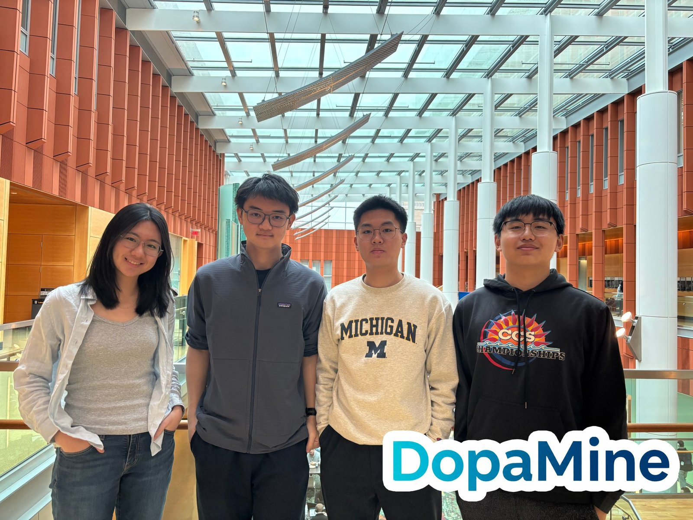

## The idea

Screen-time limits are usually rigid timers: one hour of social media, then you are locked out, whether it is a quiet Sunday or the night before a midterm. We wanted a limiter that understands context. DopaMine gives an LLM a small framework for personal time management. It looks at your deadlines and your day, then decides whether you are actually relaxing or just doomscrolling before an exam.

DopaMine took first place at the hackathon. It was the first hackathon for all four of us.

## How it works

DopaMine runs a sense–think–act loop.

| Step | What happens |
| --- | --- |
| Sense | A data API collects Canvas deadlines, calendar events, screen usage and the time of day (circadian clock). |
| Think | A decision matrix turns these signals into one of four urgency levels. |
| Act | Level 0: no action. Level 1: a normal notification, sent by iMessage. Level 2: vibration. Level 3: the app is blocked until you pass a work check. |

The [live agent debug console](https://lnkd.in/gaNzzmdd) shows the agent's reasoning step by step.
