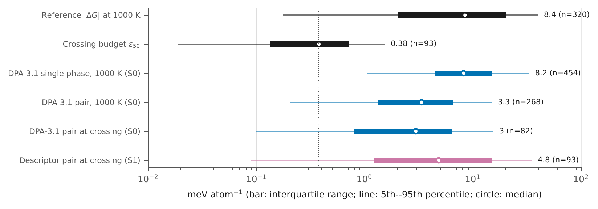
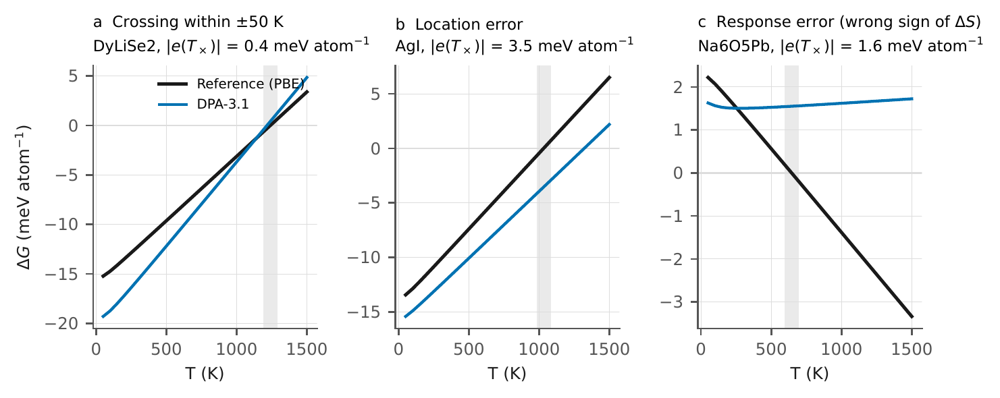

## Question

Which polymorph is stable at temperature $T$ is decided by the free-energy **difference** between competing phases, $\Delta G(T)$, and the transition sits where it crosses zero. Machine-learned interatomic potentials (MLIPs) are usually validated one structure at a time. Does per-structure accuracy tell us whether they place these crossings correctly?

## Key relation

Near a crossing $T_\times$, an error $e$ in $\Delta G$ shifts the predicted transition by

$$
\delta T_\times \approx -\frac{e(T_\times)}{\Delta S(T_\times)}, \qquad \Delta S = -\frac{\partial \Delta G}{\partial T}.
$$

Competing polymorphs have similar entropies, so $\Delta S$ is small and the crossing is sensitive to small energy errors. A temperature tolerance $\tau$ becomes a local energy budget $\varepsilon_\tau = \tau\,|\Delta S|$, which differs from pair to pair.

## Setup

- **Polymorph pairs:** same-composition pairs with a common harmonic phonon reference (PBE). These carry the statistics.
- **Finite-temperature systems:** a few systems with full reference free energies and documented transitions, including phases that are stable only at high temperature.
- **Models:** several pretrained MLIP families, all run through the same pipeline.

## Error sources on one axis

A predicted $T_\times$ passes through several layers of approximation. Every layer is compared against the same budget $\varepsilon_\tau$.

| Layer | What can go wrong |
| --- | --- |
| Reference Hamiltonian | exchange–correlation functional, dispersion |
| Potential-energy surface | MLIP vs DFT energies and curvature |
| Statistical mechanics | harmonic vs quasi-harmonic vs anharmonic |
| Numerics | supercell, q-mesh, symmetrization |
| Post-processing | root finding, interpolation |

## What is reported

| Question | Metric |
| --- | --- |
| Accurate on each phase? | single-phase thermal error |
| Accurate on the difference? | phase-relative error, error cancellation between phases, entropy-difference error |
| Right decision? | ordering, crossing within tolerance, missed and spurious crossings |
| Defined at all? | validity of the harmonic free energy (no imaginary modes) |
| Cost? | GPU time per prediction |

Invalid predictions count as failures, not as missing data.

## Figures

.")

## Notes

- Phases stabilized only by thermal fluctuations have no harmonic free energy; for those, models are evaluated through their own thermodynamic integration.
- A temperature tolerance is meaningful only relative to a stated reference level.
- Residual corrections are being tested under analysis protocols fixed before results are computed.

## Status

Manuscript in preparation. Data, stored predictions and scoring code will be released with it.

## References

- A. Loew *et al.*, Universal machine learning interatomic potentials are ready for phonons, *npj Comput. Mater.* (2025).
- J. Riebesell *et al.*, A framework to evaluate machine learning crystal stability predictions, *Nat. Mach. Intell.* **7**, 836–847 (2025).
- C. J. Bartel *et al.*, A critical examination of compound stability predictions from machine-learned formation energies, *npj Comput. Mater.* **6**, 97 (2020).
- Forslund, Jung, Ikeda and Grabowski, *npj Comput. Mater.* **12**, 14 (2026); data: [DaRUS-4999](https://doi.org/10.18419/DARUS-4999).
