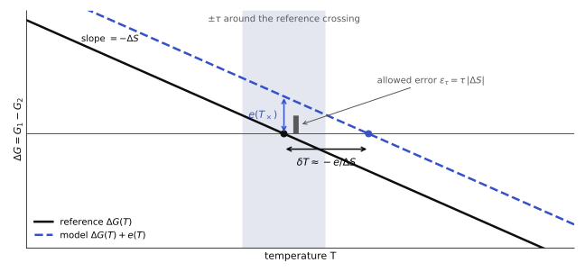
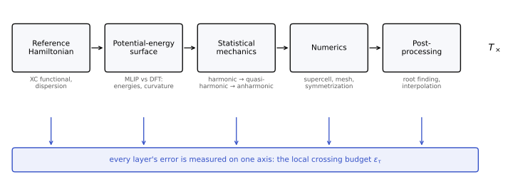

## Motivation

Which crystal structure a material adopts at a given temperature is decided by which polymorph has the lowest Gibbs free energy. Phase diagrams, synthesis conditions, high-temperature materials and mineral transitions in planetary interiors all rest on that comparison.

Machine-learned interatomic potentials (MLIPs) now approach density-functional accuracy for energies and forces, and they are increasingly used in place of DFT to compute phonons and free energies. Their thermodynamic accuracy, however, is usually judged one structure at a time. A phase decision is not made one structure at a time: it depends only on the *difference* between competing phases and on how that difference changes with temperature.

> Accuracy on each phase does not, by itself, certify accuracy on the difference between phases, and it is the difference that decides the transition.

## How much accuracy does a crossing need?

Near a simple crossing $T_\times$, an error $e$ in the free-energy difference moves the predicted transition by

$$
\delta T_\times \approx -\frac{e(T_\times)}{\Delta S(T_\times)}, \qquad \Delta S = -\frac{\partial \Delta G}{\partial T}.
$$

Competing polymorphs usually have very similar entropies, so $\Delta S$ is small at the crossing and the transition temperature is ill-conditioned: a small energy error becomes a large temperature error. Turning the question around gives a local budget: to place a crossing within $\pm\tau$, the error at the crossing must stay below $\varepsilon_\tau = \tau\,|\Delta S|$. The budget differs from one pair of phases to the next, so no single global accuracy target is meaningful.

## One axis for every source of error

A predicted transition temperature passes through several layers of approximation, and each one can move it: the reference Hamiltonian the data were computed with, the potential-energy surface the MLIP learned, the statistical-mechanical approximation used for the free energy, the numerics, and the final root finding. FES-Bench places the error from every layer on the same axis, the local crossing budget, so it becomes clear which layer dominates.

## What FES-Bench reports

The benchmark combines two kinds of data: many same-composition polymorph pairs with a common harmonic phonon reference, which carry the statistics, and a small set of systems with full finite-temperature reference free energies and documented phase transitions. Several current pretrained MLIP families are evaluated on both with the same pipeline.

| Question | What is reported |
| --- | --- |
| Is the model accurate on each phase? | single-phase thermal error |
| Is it accurate on the difference? | phase-relative error, how much error cancels between phases, entropy-difference error |
| Does it get the decision right? | polymorph ordering, crossing placed within tolerance, missed and spurious crossings |
| Can it be evaluated at all? | validity: a harmonic free energy needs a dynamically stable structure |
| At what cost? | measured GPU time per prediction |

Failures are counted rather than dropped, so a model that cannot produce a valid free energy for a structure is not rewarded for skipping it.

## Where the harmonic route stops

A harmonic free energy is defined only for a structure without imaginary phonon modes. Several technologically and geologically important phases, such as body-centred cubic transition metals and high-temperature silica, are stable only because of thermal fluctuations, and the harmonic route has no answer for them. For these systems the benchmark evaluates each model through its own finite-temperature free energy from thermodynamic integration, the same workflow that supplies free energies to mesoscale models.

## The reference is part of the answer

A tolerance in temperature only means something relative to a stated reference. Even the reference crossing can move a long way when the exchange–correlation treatment changes, as the publicly available silica data show.[^1]

. No model predictions are shown.")

FES-Bench therefore states the reference level of every target and measures fidelity to that reference, keeping agreement with experiment as a separate question.

## Toward corrections that target what matters

Knowing where the error lives suggests where a correction should act: on the difference between competing phases rather than on each phase separately, on the soft part of the vibrational spectrum where free energies are most sensitive, and relative to a baseline that is actually defined for the phase in question. We are testing physically structured residual corrections built on these principles, each under an analysis protocol that is fixed before its results are computed.

## Connection to multiscale modeling

Phase-field and other mesoscale models need free energies, interfacial energies and mobilities as input. A phase boundary in such a model is again a root of a free-energy difference, so the same question applies: how accurate must the supplied free energy be for the boundary to land where it should? FES-Bench is meant to serve as that acceptance test for free energies computed from atomistic models.

## Status

The manuscript is in preparation. The benchmark data, stored predictions and scoring code will be released together with it, so that every reported number can be regenerated without running a model or DFT.

[^1]: Silica reference data: Forslund, Jung, Ikeda and Grabowski, *npj Computational Materials* (2026), with data on DaRUS (doi:10.18419/DARUS-4999). The harmonic polymorph pairs use the Alexandria PBE phonon database of Loew et al., *npj Computational Materials* (2025).
